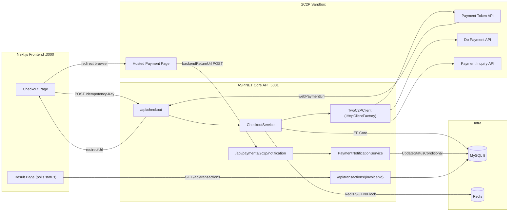

# Rezerv — Payment Integration Assessment

A full-stack checkout application integrating the **2C2P Payment API v4.3** sandbox, built for the Rezerv Payment Integration Developer assessment.

---

## Table of Contents

1. [Architecture Overview](#1-architecture-overview)
2. [Technology Stack](#2-technology-stack)
3. [Project Structure](#3-project-structure)
4. [Payment Scenarios](#4-payment-scenarios)
5. [Idempotency & Concurrency Safety](#5-idempotency--concurrency-safety)
6. [2C2P JWT Implementation](#6-2c2p-jwt-implementation)
7. [Database Schema](#7-database-schema)
8. [API Contracts](#8-api-contracts)
9. [Quick Start (Docker Compose)](#9-quick-start-docker-compose)
10. [Local Development Setup](#10-local-development-setup)
11. [Running Tests](#11-running-tests)
12. [Sandbox Credentials & Test Cards](#12-sandbox-credentials--test-cards)
13. [Environment Variables](#13-environment-variables)
14. [Security Considerations](#14-security-considerations)
15. [Known Limitations](#15-known-limitations)

---

## 1. Architecture Overview

The backend follows **Clean Architecture** with strict dependency rules:

```
Domain  ←  Application  ←  Infrastructure  ←  API
```

- **Domain**: Entities, Enums, Domain Exceptions, Repository Interfaces  
- **Application**: Use-case Services, DTOs, Validators, Payment provider abstraction  
- **Infrastructure**: EF Core, MySQL, Redis, 2C2P HTTP Client, JWT, Locking  
- **API**: ASP.NET Core Controllers, Middleware, Swagger, DI wiring  



---

## 2. Technology Stack

| Layer | Technology |
|-------|------------|
| Backend language | C# / .NET 10 |
| Web framework | ASP.NET Core 10 Web API |
| ORM | Entity Framework Core + Pomelo MySQL |
| Database | MySQL 8 |
| Cache / Lock | Redis (StackExchange.Redis) |
| Validation | FluentValidation |
| API docs | Swashbuckle / OpenAPI |
| Frontend | Next.js 15 + React + TypeScript + Tailwind CSS |
| Containerisation | Docker + Docker Compose |
| Testing | xUnit, Moq, FluentAssertions, Testcontainers |
| Payment | 2C2P v4.3 (manual HTTP + JWT HMAC-SHA256) |

> **Important:** No 2C2P SDK or NuGet package is used. JWT signing/verification and all HTTP communication are implemented manually.

---

## 3. Project Structure

```
├── backend/
│   ├── PaymentIntegration.slnx
│   ├── src/
│   │   ├── PaymentIntegration.Domain/          # Entities, Enums, Exceptions, Interfaces
│   │   ├── PaymentIntegration.Application/     # Services, DTOs, Validators, Interfaces
│   │   ├── PaymentIntegration.Infrastructure/  # EF Core, MySQL, Redis, 2C2P Client, JWT
│   │   └── PaymentIntegration.API/             # Controllers, Middleware, Program.cs
│   └── tests/
│       ├── PaymentIntegration.UnitTests/       # JwtService, CheckoutService, NotificationService
│       ├── PaymentIntegration.IntegrationTests/# Testcontainers: MySQL + Redis + WebApp
│       └── PaymentIntegration.ConcurrencyTests/# MANDATORY: 10+ concurrent requests test
├── frontend/                                   # Next.js application
│   ├── app/
│   │   ├── checkout/page.tsx                   # Main checkout page
│   │   └── result/page.tsx                     # Payment result page (polls backend)
│   ├── components/                             # Select, Spinner, PaymentSummary, StatusBadge
│   ├── services/api.ts                         # All backend API calls
│   └── types/api.ts                            # TypeScript types
├── docker-compose.yml
├── .env.example
└── README.md
```

---

## 4. Payment Scenarios

### Scenario A — OneTime Product / New Payment Method

1. User selects a **OneTime** product, clicks Pay  
2. Frontend POSTs to `POST /api/checkout` with `Idempotency-Key` header  
3. Backend creates a **Pending** transaction in MySQL  
4. Backend requests Payment Token from 2C2P (no channel restriction, no tokenization)  
5. Backend returns `redirectUrl` → frontend redirects browser to 2C2P hosted page  
6. Customer pays on the hosted page  
7. 2C2P POSTs notification to `POST /api/payments/2c2p/notification` (backend)  
8. Backend verifies JWT signature, checks amount/currency, marks transaction **Succeeded/Failed**  
9. Frontend `/result` page polls `GET /api/transactions/{invoiceNo}` until final state  

### Scenario B — Recurring Product / New Payment Method

Same as Scenario A except:
- Payment Token requested with `paymentChannel: ["CC"]` and `tokenize: true`  
- After payment, 2C2P may include `customerToken` in the backend notification  
- If `customerToken` is present in the **verified** notification, it is saved to `CustomerCard`  
- **Card is never assumed saved from payment success alone**  

### Scenario C — Recurring Product / Saved Card (Direct API)

1. User selects a **Recurring** product and one of their **saved cards**  
2. Frontend POSTs to `POST /api/checkout` with `customerCardId`  
3. Backend validates that the card belongs to this customer  
4. Backend requests Payment Token with `customerTokenOnly: true`, `request3Ds: "N"`  
5. Backend calls **Do Payment** (`POST /payment/4.3/payment`) with plain JSON  
6. If `respCode == "1001"`: 3DS redirect required → return 3DS URL to frontend  
7. If `respCode == "2000"` or other: **call Payment Inquiry to confirm**  
8. Only mark **Succeeded** when Payment Inquiry returns `respCode == "0000"`  

> ⚠️ `respCode 2000` from Do Payment does NOT mean success. Payment Inquiry is always required.

---

## 5. Idempotency & Concurrency Safety

The system prevents duplicate charges even when:
- Customers double-click the Pay button  
- The network times out and the customer retries  
- Multiple backend instances process the same request simultaneously  

### Two-Layer Idempotency

```
Layer 1: Redis distributed lock  (fast path, distributed)
Layer 2: MySQL UNIQUE(idempotency_key) constraint  (safety net)
```

**Flow:**
```
Request arrives with Idempotency-Key header
  │
  ├─ Check DB: existing transaction? → Return existing (fast path)
  │
  ├─ Acquire Redis lock (SET NX PX 15000, timeout 5s)
  │   ├─ Lock acquired: double-check DB under lock
  │   │   └─ Create transaction + call 2C2P
  │   └─ Lock not acquired: wait, re-check DB → 409 Conflict
  │
  └─ DB UNIQUE constraint: last-resort safety net for race conditions
```

The Redis lock uses a **compare-and-delete Lua script** to ensure only the owner can release it, preventing accidental release by concurrent processes.

```lua
if redis.call("get", KEYS[1]) == ARGV[1] then
    return redis.call("del", KEYS[1])
else
    return 0
end
```

### Mandatory Concurrency Test

`CheckoutConcurrencyTests` launches **10 simultaneous** HTTP requests with the **same** `Idempotency-Key` using `Testcontainers` (real MySQL + Redis):

- Exactly **1** transaction row created in MySQL  
- Payment token API called **exactly once**  
- All successful responses return the **same** `invoiceNo`  

---

## 6. 2C2P JWT Implementation

Implemented manually using `System.IdentityModel.Tokens.Jwt` without any 2C2P SDK.

### Signing (Outbound Requests)

```csharp
// HMAC-SHA256 signing
var credentials = new SigningCredentials(
    new SymmetricSecurityKey(Encoding.UTF8.GetBytes(secretKey)),
    SecurityAlgorithms.HmacSha256);
var token = new JwtSecurityToken(new JwtHeader(credentials), payload);
```

### Verification (Inbound Notifications)

```csharp
// Validates signature + algorithm
_tokenHandler.ValidateToken(jwt, new TokenValidationParameters {
    ValidateIssuerSigningKey = true,
    IssuerSigningKey = symmetricKey,
    ValidAlgorithms = new[] { SecurityAlgorithms.HmacSha256 },
    ValidateLifetime = false  // 2C2P payloads may omit exp/nbf
}, out var validatedToken);

// Reject non-HS256 tokens (prevents "none" algorithm attacks)
if (!jwtToken.Header.Alg.Equals("HS256", OrdinalIgnoreCase)) reject();
```

### Security Rules

- Merchant secret key is **never logged or exposed to the frontend**  
- Invalid signatures are **rejected before any payload processing**  
- Amount and currency are **verified against the database** before marking Succeeded  

---

## 7. Database Schema

```sql
CREATE TABLE customers (
    id          INT AUTO_INCREMENT PRIMARY KEY,
    first_name  VARCHAR(100) NOT NULL,
    last_name   VARCHAR(100) NOT NULL,
    email       VARCHAR(255) NOT NULL,
    UNIQUE KEY uq_customers_email (email)
);

CREATE TABLE products (
    id           INT AUTO_INCREMENT PRIMARY KEY,
    name         VARCHAR(255)  NOT NULL,
    description  TEXT,
    price        DECIMAL(12,2) NOT NULL,
    currency     VARCHAR(10)   NOT NULL DEFAULT 'SGD',
    payment_type TINYINT       NOT NULL   -- 0=OneTime, 1=Recurring
);

CREATE TABLE transactions (
    id              INT AUTO_INCREMENT PRIMARY KEY,
    customer_id     INT           NOT NULL,
    product_id      INT           NOT NULL,
    invoice_no      VARCHAR(100)  NOT NULL,
    idempotency_key VARCHAR(100)  NOT NULL,
    amount          DECIMAL(12,2) NOT NULL,
    currency        VARCHAR(10)   NOT NULL,
    status          TINYINT       NOT NULL,   -- 0=Pending, 1=Succeeded, 2=Failed
    payment_channel VARCHAR(50),
    masked_card_no  VARCHAR(50),
    provider_ref    VARCHAR(100),
    redirect_url    VARCHAR(500),
    resp_code       VARCHAR(10),
    resp_desc       VARCHAR(500),
    created_at      DATETIME(6)   NOT NULL,
    paid_at         DATETIME(6),
    UNIQUE KEY uq_transactions_invoice_no      (invoice_no),
    UNIQUE KEY uq_transactions_idempotency_key (idempotency_key),
    FOREIGN KEY (customer_id) REFERENCES customers(id),
    FOREIGN KEY (product_id)  REFERENCES products(id),
    INDEX idx_transactions_customer (customer_id),
    INDEX idx_transactions_created  (created_at)
);

CREATE TABLE customer_cards (
    id             INT AUTO_INCREMENT PRIMARY KEY,
    customer_id    INT          NOT NULL,
    customer_token VARCHAR(255) NOT NULL,
    masked_card_no VARCHAR(50)  NOT NULL,
    created_at     DATETIME(6)  NOT NULL,
    UNIQUE KEY uq_customer_card (customer_id, customer_token),
    FOREIGN KEY (customer_id) REFERENCES customers(id)
);
```

**Seed Data** (auto-applied on startup):
- 3 customers: Alice Smith, Bob Jones, Carol White  
- 4 products: 2 OneTime (`SGD 25.00`, `SGD 99.00`), 2 Recurring (`SGD 15.00/mo`, `SGD 49.00/mo`)  

---

## 8. API Contracts

### `POST /api/checkout`

**Request header:** `Idempotency-Key: <UUID v4>`

```json
{
  "customerId": 1,
  "productId":  2,
  "customerCardId": null
}
```

**Response `200 OK`:**
```json
{
  "invoiceNo":   "INV20261125120000001123",
  "status":      "Pending",
  "redirectUrl": "https://sandbox-pgw.2c2p.com/payment/..."
}
```

### `GET /api/transactions/{invoiceNo}`

```json
{
  "id":             1,
  "invoiceNo":      "INV20261125120000001123",
  "customerId":     1,
  "productId":      2,
  "amount":         "99.00",
  "currency":       "SGD",
  "status":         "Succeeded",
  "paymentChannel": "CC",
  "maskedCardNo":   "411111******1111",
  "providerRef":    "2026112500001",
  "respCode":       "0000",
  "respDesc":       "Payment Successful",
  "createdAt":      "2026-11-25T06:00:00Z",
  "paidAt":         "2026-11-25T06:00:30Z"
}
```

### `POST /api/payments/2c2p/notification`

Receives backend notification from 2C2P (JWT payload):
```json
{ "payload": "<JWT>" }
```
Always returns `200 OK` to acknowledge receipt (invalid payloads are rejected internally).

### `GET /api/customers` · `GET /api/customers/{id}/cards` · `GET /api/products`

Standard REST endpoints for populating the frontend dropdowns.

**Swagger UI:** `http://localhost:5001/swagger`

---

## 9. Quick Start (Docker Compose)

```bash
# 1. Clone the repository
git clone <repo-url> && cd <repo-directory>

# 2. (macOS) Start Colima if not already running
colima start

# 3. Build and start all services
docker compose up --build

# 4. Wait for all services to be healthy, then open:
#    Frontend:  http://localhost:3000
#    Swagger:   http://localhost:5000/swagger
#    API:       http://localhost:5000/api
```

> **Note:** Database migrations and seed data are applied automatically when the backend starts.

---

## 10. Local Development Setup

### Prerequisites

- .NET 10 SDK
- Node.js 20+
- MySQL 8 (local or Docker)
- Redis (local or Docker)

### Backend

```bash
# Start supporting services
docker run -d --name dev-mysql -p 3306:3306 \
  -e MYSQL_ROOT_PASSWORD=root -e MYSQL_DATABASE=payment_db \
  -e MYSQL_USER=payment_user -e MYSQL_PASSWORD=payment_password \
  mysql:8.0

docker run -d --name dev-redis -p 6379:6379 redis:7-alpine

# Apply migrations
cd backend
dotnet dotnet-ef database update \
  --project src/PaymentIntegration.Infrastructure \
  --startup-project src/PaymentIntegration.API

# Run the API
dotnet run --project src/PaymentIntegration.API
# → http://localhost:5000
# → Swagger: http://localhost:5000/swagger
```

### Frontend

```bash
cd frontend
npm install
npm run dev
# → http://localhost:3000
```

---

## 11. Running Tests

> Tests use **Testcontainers** — Docker must be running.

```bash
# All tests
cd backend && dotnet test

# Unit tests only (no Docker required)
dotnet test tests/PaymentIntegration.UnitTests/

# Integration tests (requires Docker)
dotnet test tests/PaymentIntegration.IntegrationTests/

# Concurrency tests (MANDATORY — requires Docker)
dotnet test tests/PaymentIntegration.ConcurrencyTests/

# With coverage
dotnet test --collect:"XPlat Code Coverage"
```

### Key Tests

| Test | File | Purpose |
|------|------|---------|
| `SignAndVerify_RoundTrip_ShouldSucceed` | `JwtServiceTests.cs` | JWT round-trip |
| `Verify_TamperedSignature_ShouldFail` | `JwtServiceTests.cs` | Reject tampered JWT |
| `Verify_NoneAlgorithmToken_ShouldFail` | `JwtServiceTests.cs` | Prevent alg=none attack |
| `ProcessCheckout_ExistingIdempotencyKey_ReturnsExisting` | `CheckoutServiceTests.cs` | Idempotency fast path |
| `ProcessCheckout_RecurringProduct_TokenizeEnabled` | `CheckoutServiceTests.cs` | Tokenize flag set |
| `ProcessNotification_InvalidSignature_IsRejected` | `PaymentNotificationServiceTests.cs` | Signature gate |
| `ProcessNotification_AmountMismatch_MarksTransactionFailed` | `PaymentNotificationServiceTests.cs` | Amount verification |
| `ProcessNotification_DuplicateCard_NotSavedTwice` | `PaymentNotificationServiceTests.cs` | Idempotent card saving |
| **`TenConcurrentCheckoutsWithSameIdempotencyKey_ProducesExactlyOneTransaction`** | `CheckoutConcurrencyTests.cs` | **Mandatory concurrency test** |

---

## 12. Sandbox Credentials & Test Cards

### Sandbox Merchant

| Field | Value |
|-------|-------|
| Merchant ID | `JT01` |
| Secret Key | `7jYcp4FxFdf0` |
| Base URL | `https://sandbox-pgw.2c2p.com` |

### Singapore Test Cards

| Card Number | Type | Behaviour |
|-------------|------|-----------|
| `4111111111111111` | Visa | Success |
| `5500005555555559` | MasterCard | Success |
| `4000000000003063` | Visa | 3DS triggered |
| `4000000000000002` | Visa | Decline |

**CVV:** any 3 digits · **Expiry:** any future date

### 2C2P Response Codes

| Code | Meaning |
|------|---------|
| `0000` | **Payment Successful** (from Payment Inquiry only) |
| `1001` | 3DS redirect required (from Do Payment) |
| `2000` | Do Payment completed — **must verify via Payment Inquiry** |
| `9999` | General failure |

---

## 13. Environment Variables

Override any value via Docker Compose `environment:` or via system environment variables:

| Variable | Description | Default |
|----------|-------------|---------|
| `ConnectionStrings__DefaultConnection` | MySQL connection string | (see appsettings.json) |
| `Redis__ConnectionString` | Redis host:port | `localhost:6379` |
| `TwoC2P__MerchantId` | 2C2P Merchant ID | `JT01` |
| `TwoC2P__SecretKey` | HMAC signing secret | `7jYcp4FxFdf0` |
| `TwoC2P__BaseUrl` | Payment gateway base URL | `https://sandbox-pgw.2c2p.com` |
| `TwoC2P__FrontendReturnUrl` | URL customer is redirected to after hosted payment | `http://localhost:3000/result` |
| `TwoC2P__BackendReturnUrl` | URL 2C2P POSTs notification to | `http://localhost:5000/api/payments/2c2p/notification` |
| `TwoC2P__TimeoutSeconds` | HTTP client timeout | `30` |
| `NEXT_PUBLIC_API_URL` | Frontend → Backend URL | `http://localhost:5000` |

---

## 14. Security Considerations

- **Merchant secret key** is never sent to the frontend or logged  
- **JWT signature verified** before any notification payload is processed  
- **Amount and currency cross-checked** against database values on every notification  
- **Card numbers never stored** — only the opaque `customerToken` from 2C2P  
- **CVV never stored or logged** at any point  
- **Non-root Docker users** in both backend and frontend containers  
- **Idempotency enforced at two levels** (Redis + MySQL) to prevent double charges  
- **Transaction status never read from URL/query params** — always fetched from the database  

---

## 15. Known Limitations

- **`backendReturnUrl`**: For 2C2P sandbox to reach your local backend, you need a tunnel (e.g., `ngrok http 5000`) when running locally. Docker Compose wires this internally via `http://backend:8080/...`.
- The concurrency tests use Testcontainers and require Docker. They may take 60–90 seconds on the first run due to image pulls.
- Scenario C (saved card, Direct API) in the sandbox may require specific 2C2P merchant configuration to enable customer tokenization.

---

*Assessment submission for Rezerv Payment Integration Developer role.*
